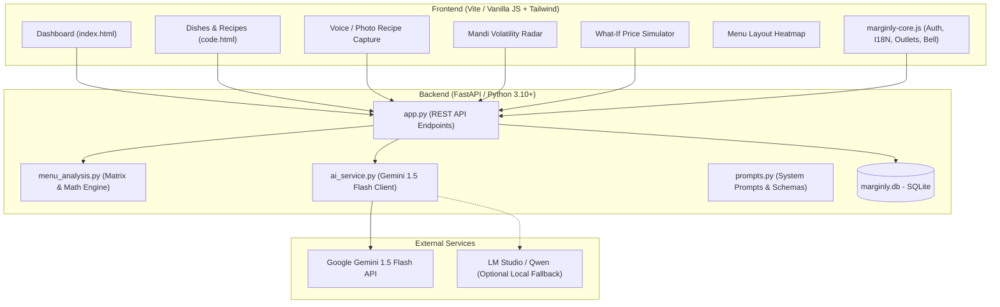

# Marginly — Comprehensive Project Architecture & Concept Brief

> **Context Document for AI Pair-Programmers (Claude / Gemini)**  
> **Repository:** `https://github.com/nawayushh/Marginly.git`  
> **Workspace:** `Marginly/` (FastAPI Backend + Vite HTML/JS Frontend)

---

## 1. Executive Summary & Vision

**Marginly** (formerly MenuMitra) is an **AI-powered recipe costing, plate margin engineering, and real-time raw material intelligence operating system tailored specifically for Indian restaurants, cafés, and cloud kitchens**.

### The Core Problem in the Indian F&B Sector
Most Indian restaurant owners, independent café operators, and head chefs price their menus by guesswork or competitor imitation. They face three chronic vulnerabilities:
1. **Volatile Mandi Pricing:** Key raw materials (tomatoes, dairy/milk, onions, edible oil, LPG cylinders) experience wild 20%–100% price swings in local wholesale mandis within days. Menu card prices remain frozen, silently wiping out gross margins.
2. **Hidden Profit Leaks ("Plowhorses" & "Dogs"):** Fast-selling dishes often have high ingredient costs and razor-thin margins (Plowhorses), generating high revenue but zero net cash. Conversely, high-margin specialties don't sell because of poor menu placement (Puzzles).
3. **Friction of Recipe Costing:** Chefs speak in kitchen slang (*"do chamach garam masala"*, *"ek katori dahi"*, *"ek packet Amul butter"*). They do not maintain complex spreadsheets or calculate per-gram ingredient weights.

Marginly solves this with **conversational AI recipe ingestion (Hindi/Hinglish voice & diary OCR)**, **live wholesale mandi price radar**, and **mathematical Menu Engineering Matrix (BCG Matrix adapted to restaurant covers)**.

---

## 2. Core Economic Engine & Mathematical Formulas

Every calculation in Marginly adheres to standard hospitality culinary economics:

### A. Plate Economics
$$\text{Contribution Margin (CM)} = \text{Selling Price} - \text{Raw Ingredient Cost (Food Cost)}$$

$$\text{Food Cost Percentage} = \left(\frac{\text{Raw Ingredient Cost}}{\text{Selling Price}}\right) \times 100$$
*(Target benchmark for Indian cafés/dine-in: 28% – 35%)*

### B. Menu Item Performance
$$\text{Item Revenue} = \text{Selling Price} \times \text{Quantity Sold}$$

$$\text{Item Total Food Cost} = \text{Raw Ingredient Cost} \times \text{Quantity Sold}$$

$$\text{Item Total Contribution Profit} = \text{Contribution Margin} \times \text{Quantity Sold}$$

$$\text{Popularity Share (\%)} = \left(\frac{\text{Dish Quantity Sold}}{\text{Total Restaurant Units Sold}}\right) \times 100$$

### C. The Kasavana & Smith Menu Engineering Matrix
Dishes are categorized into 4 quadrants against benchmark thresholds:
- **Average Contribution Margin Threshold:** $\overline{\text{CM}} = \frac{\sum \text{Item Total Profit}}{\sum \text{Total Units Sold}}$
- **Popularity Benchmark Threshold:** $\text{Pop Threshold} = \frac{100\%}{\text{Total Distinct Dishes}} \times 0.70$ (70% hurdle rate)

| Quadrant | Margin | Popularity | Strategy / Action |
|---|---|---|---|
| ⭐ **Stars** | **High** | **High** | Protect recipe quality; maintain prominent placement on top-right menu sweet spot; never discount. |
| 🐎 **Plowhorses** | **Low** | **High** | High sales but low profit! Reduce portion size slightly, substitute secondary ingredients, or cautiously hike price by 5–10%. |
| 🧩 **Puzzles** | **High** | **Low** | Highly profitable but unpopular! Reposition on menu, train floor staff to recommend, pair in combos. |
| 🐕 **Dogs** | **Low** | **Low** | Profit drainers. Phase out, replace with high-margin items, or eliminate from kitchen prep lists. |

---

## 3. Strict Development Principles & Non-Negotiable Rules

When coding or refactoring Marginly, the following rules must **never** be broken:

### Rule 1: Zero Fake Data on Registration (Clean Slate Policy)
- When a new restaurant registers, the database must contain **0 dishes, 0 sales, and 0 calculations**.
- **No sample starter packages or dummy dishes** (`abc123` test account dishes must never bleed into new accounts).
- All dashboard KPI cards, matrices, and charts must show neutral empty states (₹0 / 0% / "No dishes added yet") until the operator enters their real menu and sales volume.

### Rule 2: Ultra-Lean Gemini AI Token Consumption
- Local restaurants operate on tight margins; the AI layer must not exhaust free/low-tier API quotas.
- Every Gemini call in `backend/ai_service.py` must enforce:
  - `maxOutputTokens: 250 - 350`
  - `temperature: 0.1 - 0.2`
  - Compact JSON-only schema outputs with zero conversational filler.

### Rule 3: Top Navigation Bar Consistency Across All Pages
- All 6 core screens must share the **exact same Marginly Pro unified header**:
  - Consistent logo, outlet selector, live mandi radar bell, theme toggle, bilingual switch (`EN | हिं`), user profile avatar, and logout button.
  - Zero layout shift when moving between Dashboard, Dishes, Add Recipe, Menu Layout, Price Alerts, and What-If Simulator.

### Rule 4: Production Realism for Indian F&B Operators
- All default units must match Indian procurement standards:
  - Quantities: `kg`, `g`, `L`, `ml`, `piece/nos`, `cylinder`
  - Currency: `₹ (INR)`
  - Common ingredients: Amul Butter, Paneer, Refined Sunflower Oil, Mustard Oil, Basmati Rice, LPG 19kg Commercial Cylinder, Tomatoes, Onions, Green Chillies.

---

## 4. System Architecture & Tech Stack



### Technology Breakdown
- **Backend:** Python 3.10+, FastAPI, Uvicorn, SQLite3, Pydantic, HTTPX, Python-dotenv.
- **Frontend:** Vite, HTML5, Tailwind CSS, Material Symbols Outlined, Chart.js.
- **AI Integration:** Google Gemini API (`gemini-1.5-flash` or `gemini-2.5-flash`) via standard REST payload to Google AI Studio API. Optional fallback to LM Studio (port 1234/1235).
- **Client Core:** `frontend/marginly-core.js` acts as an omni-present UI orchestration layer injecting auth tokens, session state, dark mode styles, outlet switching, and bidirectional English <-> Hindi translation.

---

## 5. Key Feature Workflows

### 1. Onboarding & Registration Flow (`register.html`)
- Operator inputs: Username, Password, Restaurant Name, Cuisine Type, City / Mandi Region (e.g. *"Rajpur Road, Dehradun"* or *"Indiranagar, Bengaluru"*), Phone/WhatsApp number.
- Optional: User clicks **"Fetch Mandi Rates"** -> triggers Gemini with prompt `build_market_insights_prompt()` returning local price benchmarks for staple ingredients.
- On form submission -> user record created in `users` table with 0 starter items -> immediate redirect to `login.html` or direct authenticated session.

### 2. Multi-Modal Recipe Capture (`menumitra_add_recipe_smart_voice_photo_capture/code.html`)
Three modes to record recipes without manual spreadsheet entry:
- **Speak it (Voice Capture):** Audio recorded in Hindi / Hinglish -> backend parses kitchen phrases (e.g. *"100 gram paneer, 2 chammach butter, aadha cup cream"*) into structured gram weights and costs.
- **Photograph it (Camera / OCR):** Upload photo of handwritten kitchen diary / supplier invoice -> Gemini extracts ingredient lines, pack sizes, and prices.
- **Type it (Manual Entry):** Manual table for exact gram weights and waste yield adjustments.

### 3. Real-Time Mandi Price Alerts (`menumitra_price_alerts_volatility_radar/code.html`)
- Operators view live wholesale shifts affecting their region.
- Clicking **"Scan Live Rates"** calls `POST /api/alerts/sync-live-mandi` -> calls `ai_service.check_realtime_mandi_alerts(location)`.
- Returns structured JSON array of 3–4 current spikes/drops (e.g. *"Tomatoes +24% due to seasonal mandi supply crunch in Nashik"*).
- Alerts are deduplicated and saved to the SQLite `alerts` table.
- Operators can dismiss alerts or simulate dish price impacts.

### 4. What-If Scenario Simulator (`menumitra_what_if_simulator/code.html`)
- Allows operators to test:
  - *"If I increase Cold Coffee from ₹120 to ₹135, and sales drop by 8%, what is the net impact on monthly restaurant profit?"*
- Calculates real-time elasticity and net profit change before risking actual menu card re-prints.

### 5. Printed Menu Layout Heatmap (`menumitra_printed_menu_layout_heatmap/code.html`)
- Visualizes the restaurant menu layout using the **Golden Triangle rule** of menu design (Eye starts at middle -> top right -> top left).
- Recommends placing **Stars** in the top-right sweet spot to maximize impulse orders.

---

## 6. Directory Structure & Key Files

```
Marginly/
├── backend/
│   ├── app.py              # FastAPI server: auth, dishes, matrix analysis, mandi alerts
│   ├── ai_service.py       # Gemini API client & fallback handlers (capped tokens)
│   ├── prompts.py          # Strict JSON system prompts (mandi radar, recipe extraction)
│   ├── menu_analysis.py    # Math engine: CM, food cost %, popularity %, classification
│   ├── config.py           # Environment variables loader
│   ├── requirements.txt    # Python deps (fastapi, uvicorn, pydantic, httpx, etc.)
│   ├── .env.example        # Env template (GEMINI_API_KEY, HOST, PORT, etc.)
│   ├── .gitignore          # Git exclusion (strictly excludes .env and marginly.db)
│   └── marginly.db         # SQLite runtime database
│
├── frontend/
│   ├── index.html           # Main analytics dashboard & 4-quadrant matrix
│   ├── login.html           # Authentication login portal
│   ├── register.html        # Clean onboarding & mandi rate calibration
│   ├── marginly-core.js     # Shared header, auth interceptor, EN/HI translation, modals
│   ├── vite.config.js       # Vite dev server configuration
│   ├── package.json         # Frontend npm dependencies
│   └── menumitra_*/         # Deep-dive sub-modules:
│       ├── menumitra_dishes_recipes/
│       ├── menumitra_add_recipe_smart_voice_photo_capture/
│       ├── menumitra_price_alerts_volatility_radar/
│       ├── menumitra_what_if_simulator/
│       └── menumitra_printed_menu_layout_heatmap/
│
└── README.md               # Setup and execution guide
```

---

## 7. Windows Environment Quirks & Operational Run Commands

When running or troubleshooting on this Windows workstation:
1. **PowerShell Script Execution is Restricted:** Do not execute `.ps1` files (like `Activate.ps1`). Use standard Command Prompt (`CMD`) commands.
2. **Node.js Path:** If `npm` is not in system `PATH`, use `"C:\Program Files\nodejs\npm.cmd"`.
3. **Python Path:** Anaconda Python is at `C:\Users\Ayushh.DESKTOP-JFAR8C1\anaconda3\python.exe`, and backend virtualenv is at `backend\venv\Scripts\python.exe`.
4. **Port Conflicts (`WinError 10048`):** If port 8000 is occupied, kill the existing process:
   ```cmd
   for /f "tokens=5" %a in ('netstat -aon ^| findstr :8000') do taskkill /f /pid %a
   ```

### Execution Reference:
- **Backend (Port 8000):**
  ```cmd
  cd backend
  venv\Scripts\activate.bat
  python -m uvicorn app:app --host 127.0.0.1 --port 8000
  ```
- **Frontend (Port 5173):**
  ```cmd
  cd frontend
  "C:\Program Files\nodejs\npm.cmd" run dev
  ```

---

## 8. Current State & Pending Roadmap

| Feature / Component | Status | Next Milestone |
|---|---|---|
| **Unified Top Bar** | Complete | Identical across all 6 pages with zero layout shift |
| **Clean Registration** | Complete | Zero fake dishes or auto-imported items |
| **Real-Time Mandi Radar** | Complete | Backend synced with Gemini, dynamic alerts UI |
| **Security & Gitignore** | Complete | `.env` and `marginly.db` protected from repository |
| **Bilingual Toggle (EN/हिं)** | Partial | Header translates fully; deeper dynamic body elements require expanded `I18N` dictionary coverage |
| **Gemini Model Tag Calibration** | Polish | Verify active model name in `.env` (`gemini-1.5-flash` or `gemini-2.5-flash`) |
